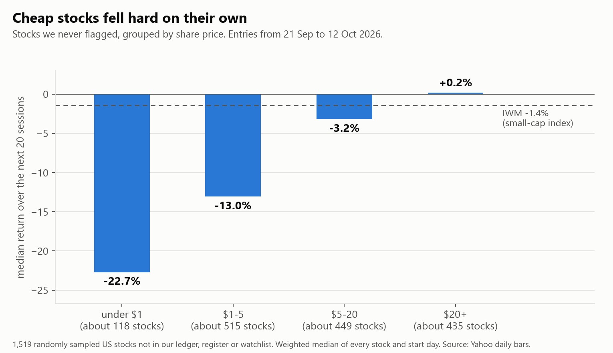
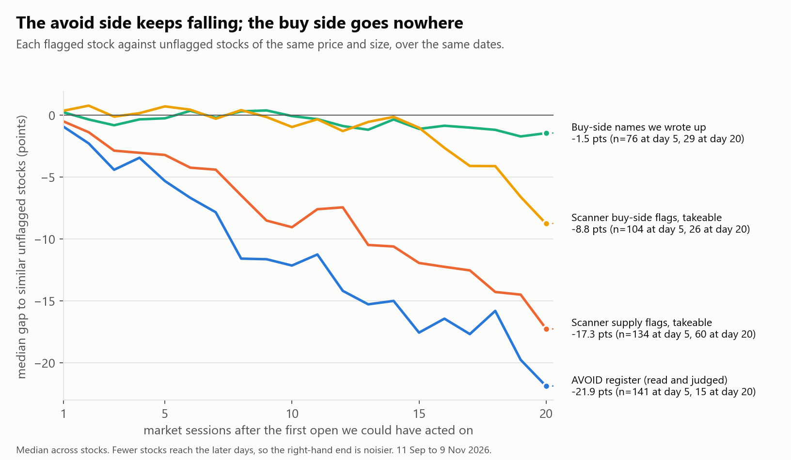
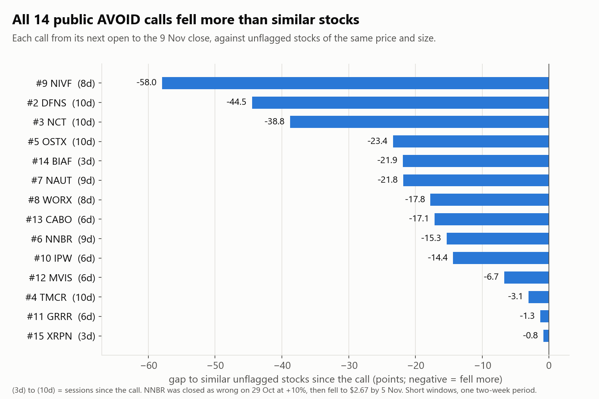
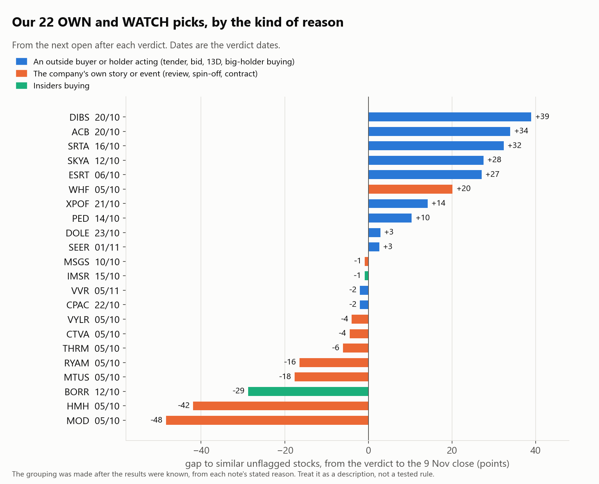

# Two-month review: what we flagged, why, and what it did

*Written 10 Nov 2026. Covers everything found from 11 Sep to 6 Nov, priced to the 9 Nov close: 1,569 ledger rows on 1,052 stocks, 252 AVOID register rows, 22 OWN or WATCH verdicts, 15 public calls and 23 triggers.*

## The short answer

1. **Our yardstick was wrong, and it hid the real picture.** We scored everything against IWM. But over these weeks an ordinary stock under $5 that we never flagged lost a median 13% in 20 sessions, and one under $1 lost 23%, while IWM lost 1.4%. Against IWM, every avoid looked brilliant and every buy looked terrible. Against similar stocks, the picture is different.
2. **The avoid side is real.** After taking out what similar stocks did, the scanner's supply flags still fell a further 9 points in 10 sessions and 16 in 20. All 14 public AVOID calls fell more than similar stocks (median 17 points more).
3. **The buy side, taken as a whole, is a coin flip.** The scanner's buy-side flags did nothing for two weeks and then lagged. The names we wrote up matched similar stocks almost exactly. After your 3.5% round-trip cost, the average of our 22 verdicts is a loss of 3.2%.
4. **Inside the buy side, one kind of pick worked.** Where an outside buyer or holder was acting (a tender, a bid, a 13D with a demand, a big holder buying), 10 of 11 picks rose, averaging +14.9%. Where the reason was the company's own story (a review, a spin-off, a contract), 3 of 9 rose, averaging -12.6%. That split was drawn after the results, so it is a lead to test, not a finding.
5. **Nearly every big move came on a scheduled news day.** MOD, HMH, RYAM and MTUS lost most of their fall in the sessions around Q3 results. ACB, XPOF, SRTA and DIBS made most of their gain on one or two filing days. Our triggers fired on those same days, which is too late to act.

"Similar stocks" means this throughout: unflagged stocks in the same share-price band and the same market-value band, measured over the same dates. The method is at the end.

## 1. The yardstick: cheap stocks fell on their own

| Share price at the start | Median over the next 20 sessions |
|---|---|
| under $1 | -22.7% |
| $1 to $5 | -13.0% |
| $5 to $20 | -3.2% |
| $20 or more | +0.2% |
| IWM | -1.4% |

These are 1,519 stocks chosen at random from everything we did **not** flag, for every start day from 21 Sep to 12 Oct. Most of what the scanner flags is under $5. So "fell 25%, beat IWM by 24 points" mostly described the neighbourhood, not the flag.

## 2. The avoid side

Median gap to similar stocks, in points. Negative means the flagged stock fell more.

| Group | Stocks | 5 sessions | 10 sessions | 20 sessions | Fell more than similar stocks |
|---|---|---|---|---|---|
| Scanner supply flags, takeable | 147 | -2.8 | -8.5 | -16.0 | 78% at 20 sessions |
| Reverse splits | 58 | -2.4 | -9.6 | -19.0 | 83% |
| Registrations declared effective | 87 | -2.9 | -6.4 | -10.6 | 74% |
| New share registrations | 17 | -3.9 | -13.1 | -17.0 | 75% |
| AVOID register (read and judged) | 221 | -5.3 | -12.2 | -21.9 | 67% at 5, 71% at 10 |
| Supply flags we never put on the register | 233 | -1.7 | -2.4 | -10.2 | 66% at 20 |

- **The fall is steady, not instant.** It builds over four weeks, so the day-after entry does not miss it.
- **Reading helps here.** The names we read and put on the register fell much faster in the first two weeks than the flags we passed over (-5.3 against -1.7 at 5 sessions, -12.2 against -2.4 at 10). The averages are not statistically different (p = 0.22), because of the squeezes below.
- **By reason, at 10 sessions:** distress -19.2 (11 names), ongoing share sales -12.5 (31), holders free to sell -11.2 (4), deal dilution -4.5 (5), one-off offerings -4.0 (13). Takeable one-off offerings were **+5.7** (5 names). That matches the 27 Oct rule that a priced one-off is not an AVOID.

- **Public calls:** 14 of 14 AVOID calls fell more than similar stocks: median 17.4 points more, mean 20.3. Against IWM the median was 19.8, so the fairer yardstick takes off only about 2 points. These windows are 3 to 10 sessions, all in one fortnight.
- **The catch: the median falls, the average does not.** For takeable register names at 10 sessions the median gap is -11.3 but the mean is **+1.8** (95% interval -16.8 to +32.2). A few squeezes do that: AIOK rose 166% in 16 sessions. So this is a good don't-buy list and a good public record. It is not, on this evidence, a way to make money betting against these stocks.
- **Lock-up notices and delistings** behaved like supply: takeable lock-ups -7.5 at 10 sessions (18 names), delistings -19.1 at 20 (5 names).

## 3. The buy side: what the scanner flags

Median gap to similar stocks, takeable names only (first flag per stock).

| Why it was flagged | Stocks | 5 sessions | 10 sessions | 20 sessions |
|---|---|---|---|---|
| All buy-side flags | 148 | +0.7 | -0.8 | -8.7 (29 judged) |
| "Strategic review" 8-Ks | 85 | +0.5 | -0.4 | -13.2 (6) |
| New 13Ds | 54 | +0.5 | -1.4 | -9.4 (17) |
| Issuer tenders and buybacks | 11 | +0.5 | +2.2 | +2.0 (3) |
| Signed deals (price pinned) | 202 | -0.1 | -0.7 | -0.1 (37) |
| Spin-off 8-Ks | 66 | +0.2 | -0.2 | -1.8 (6) |
| Special dividends | 41 | +1.7 | +0.7 | too few |
| IPOs priced | 16 | -2.7 | -3.0 | too few |

- **We are not late.** The typical strategic-review or 13D flag did not move on the day it was filed (median 0.0%). There was simply no drift afterwards.
- **A raw 13D or "strategic review" hit is not a buy signal.** Many are financings, control filings or distressed companies using the phrase. The worst two were JAGX (-93%) and OPNW (-90%), both scanner hits we never wrote up.
- **Special dividends** are the one small positive pocket: +1.7 points in 5 sessions, 76% ahead of similar stocks (25 names). The interval on the mean (-0.9 to +4.9) includes zero, and it is smaller than your trading cost.
- Across all 511 takeable long-side names, 47% beat similar stocks. Median gap: -0.4 points.

## 4. The buy side: what we wrote up

| Group (as filed in the found list) | Names | Median gap to date | Mean | Beat similar stocks |
|---|---|---|---|---|
| Activists and big holders | 20 | +2.6 | +5.2 | 13 of 20 |
| Merger arb and tenders | 31 | 0.0 at 10 sessions | +1.9 | half |
| Contracts and catalysts | 17 | -2.1 | -5.4 | 7 of 17 |
| Insider buying | 18 | -2.2 | -4.6 | 7 of 18 |
| **Every long-side name we wrote up** | 92 | -0.1 at 10 sessions, -1.5 at 20 | -2.8 at 20 | 38% at 20 |
| Scanner buy flags we passed over | 116 | -1.8 at 10 sessions, -9.4 at 20 | -15.1 at 20 | 26% at 20 |

- **Reading kept us out of the worst.** At 20 sessions the flags we passed over were 15 points behind similar stocks on average (interval -28.9 to -3.0). The names we wrote up were about level (interval -8.0 to +2.5).
- **But level is not an edge.** Our write-ups as a whole did what similar stocks did.
- **Activists and big holders did best; contracts and insider buying did worst.** Activists against the other two groups combined: p = 0.04. That is suggestive at this size, not proof.
- **The 5 Oct "long-term" names** (MTUS, MP, UAMY, VRT, AAON, CLF, PUSA, ELMT) were 13.6 points behind similar stocks at 20 sessions. They were stories that had already run.
- **Insider clusters:** -4.7 at 5 sessions and -13.2 at 10 (small numbers). This agrees with the IC1 test.

## 5. Our 22 verdicts

From the next open after each verdict to the 9 Nov close.

| Verdict | Stock | Reason given | Entry | Stock since | Similar stocks | Gap |
|---|---|---|---|---|---|---|
| 20/10 | DIBS | billionaire family keeps buying | $4.30 | +34.7% | -4.3% | +39.0 |
| 20/10 | ACB | hostile bid, rival possible | $3.98 | +29.6% | -4.3% | +34.0 |
| 16/10 | SRTA | Third Point 13D asks for a sale | $4.56 | +32.7% | +0.3% | +32.4 |
| 12/10 | SKYA | $3.00 tender, 16% gap | $2.51 | +17.5% | -10.0% | +27.6 |
| 06/10 | ESRT | 13D asking for a review | $4.39 | +21.4% | -5.7% | +27.1 |
| 05/10 | WHF | BDC sale review, below NAV | $7.06 | +17.2% | -2.9% | +20.1 |
| 21/10 | XPOF | holder at its 19.9% cap inside a sale review | $4.29 | +10.5% | -3.7% | +14.2 |
| 14/10 | PED | 34% holder buys $1.9M | $13.04 | +11.3% | +0.9% | +10.4 |
| 23/10 | DOLE | Pale Fire buying a fifth | $13.38 | +4.5% | +1.6% | +2.9 |
| 01/11 | SEER | bids rejected, at half of net cash | $1.68 | 0.0% | -2.6% | +2.6 |
| 10/10 | MSGS | Rangers spin-off | $404.36 | +4.6% | +5.5% | -0.9 |
| 15/10 | IMSR | CEO and two directors buy | $3.24 | -7.4% | -6.5% | -0.9 |
| 05/11 | VVR | Saba 13D at a 12.5% discount | $2.86 | +1.4% | +3.4% | -2.0 |
| 22/10 | CPAC | Holcim going-private tender | $12.78 | +0.2% | +2.1% | -2.0 |
| 05/10 | VYLR | spin-off | $71.91 | +0.9% | +4.9% | -4.0 |
| 05/10 | CTVA | spin-off | $13.08 | -7.4% | -2.9% | -4.5 |
| 05/10 | THRM | special dividend and deal | $32.23 | -5.7% | +0.3% | -6.1 |
| 05/10 | RYAM | strategic review | $6.98 | -18.5% | -2.0% | -16.5 |
| 05/10 | MTUS (OWN) | funded DLA contract | $21.13 | -17.3% | +0.3% | -17.7 |
| 12/10 | BORR | director's $32M of buying | $4.98 | -35.3% | -6.6% | -28.8 |
| 05/10 | HMH | overhang clears | $19.11 | -43.9% | -2.0% | -41.9 |
| 05/10 | MOD | spin and merger with a THRM unit | $188.00 | -43.5% | +4.9% | -48.4 |

| Kind of reason | Picks | Rose | Mean return | After 3.5% cost | Mean gap to similar stocks |
|---|---|---|---|---|---|
| An outside buyer or holder acting | 11 | 10 | +14.9% | +11.4% | +16.9 |
| The company's own story or event | 9 | 3 | -12.6% | -16.1% | -13.3 |
| Insiders buying | 2 | 0 | -21.4% | -24.9% | -14.8 |
| **All 22** | 22 | 13 | +0.3% | -3.2% | +1.7 |

- **The difference between the first two rows is large** (p = 0.001 on a shuffle test). But I sorted the picks into kinds after seeing the results, and 22 picks is small. The found-list groups in section 4 were set before the results, and they point the same way more weakly.
- **What decided them.** Results days and filing days:
  - MOD -21.4% on 4 Nov, the session after its results.
  - HMH -22.4% on 5 Nov, the session after its results.
  - MTUS -7.6%, -9.2% and -11.8% on 3 to 5 Nov, on its results and Q4 guide.
  - RYAM -9.2% and -9.1% on 5 and 6 Nov, after its results and 10-Q.
  - ACB +22.3% on 3 Nov (board-backed deal). XPOF +19.3% on 30 Oct (a holder's 13D/A with a cash proposal). SRTA +17.6% on 4 Nov and DIBS +8.6% on 5 Nov (results days).
- **Every early-October WATCH sat through Q3 results.** We never wrote the results date on a WATCH. The 5 Nov MTUS rule covers open positions only.
- **Kills:** CHDN, killed on 5 Oct as a false positive, is +26.8% since. TWST, marked AVOID the same day, is -35.4%. ELMT is covered in the 10 Nov note.

## 6. Triggers

23 triggers set, 4 fired, 2 expired, 2 cancelled, 15 open. None led to a trade.

- **DIBS and ACB fired on the price-moving news itself** (the 4 Nov rule came from this), after most of the move.
- **ELMT and ARTV fired on 9 Nov** and the re-read said no call.
- The two best WATCH outcomes would only have paid if bought at the WATCH, before any trigger. So in practice the WATCH list has been the buy list, and the trigger has been a confirmation that arrives after the move.

## 7. What this means for the two pre-registered tests

- **TF1 (the buy filter) was not touched.** Its test items (found from 22 Oct) were not split by the filter here.
- **A caution for reading TF1 later.** TF1 scores against IWM. In the older exploration set, the price rule ($5 or more against under $5) showed a gap of 21 points against IWM but only 4 against similar stocks. Most of that leg was the cheap-stock slide. The "fell 10% or more in the 5 days before" leg held up: those names were 22 points behind similar stocks at 20 sessions, against 6 for the rest.
- **AV1 (the AVOID test) is still the official test.** It uses 10 closely matched controls per AVOID and reads once 30 rows are judged. This review used a coarser comparison and is description only. Its progress table is being refreshed today.

## 8. Limits

- **Two months, one market.** Cheap stocks were sliding the whole time. A supply flag may matter less in a rising market.
- **Small groups.** Anything with fewer than 20 judged names is a hint.
- **Many cuts.** Dozens of groups were looked at, so some gaps will be chance. The supply result is the only one that is large, consistent across every sub-group and present at every horizon.
- **The comparison group** holds stocks still listed on 10 Nov, so it leaves out any that were delisted since. That makes similar stocks look slightly better and our flags slightly worse.
- **Prices** are Yahoo daily bars, adjusted for splits and dividends. 12 tickers with broken data were dropped, and 89 ledger rows had no usable prices.
- **Entry** is the next open after the find. Costs are shown only where stated.

## 9. What I would do with this

No new filters. These are bookkeeping changes and one thing to stop.

1. **Score against similar stocks, not IWM.** Add the "similar stocks" column to the calls scoreboard and the found list. The AVOID record still stands on that basis (14 of 14).
2. **Keep AVOID as the public product.** It is the one thing with measured information in it. Keep describing it as a don't-buy list.
3. **Write the next results date on every WATCH**, with one line on whether the reason survives a bad quarter. Four of the six big losers were lost there.
4. **Record who is acting on every new WATCH** (outside buyer or holder, the company itself, insiders). No rule yet. Read it alongside TF1 once 20 or more have 20 sessions behind them.
5. **Stop treating a raw 13D or "strategic review" hit as a lead by itself.** The reading is what separates them.
6. **Costs.** At £40 to £50 a trade the 3.5% round trip turned the all-verdict average from +0.3% to -3.2%. Only the outside-buyer group cleared it.

## Method

- **Entry:** the first open after the find or verdict date. **Returns:** to the close 5, 10 and 20 market sessions later, or to the 9 Nov close, on prices adjusted for splits and dividends.
- **Similar stocks:** a seeded random sample of 1,550 US stocks that never appeared in the ledger, the AVOID register or the watchlist (1,519 with clean prices). For each flagged stock and start day, the comparison is the weighted median return of sampled stocks in the same price band (under $1, $1 to $5, $5 to $20, $20 or more) and market-value band (under $50M, $50M to $300M, $300M to $2B, $2B or more). Weights correct for the sample taking a different share of each size pool.
- **Takeable:** $1 or more and a 20-day median of $150k a day at the find.
- **First flag per stock** in each group, so a stock flagged five times counts once.
- **Intervals** are bootstrap 95% intervals on the mean; **p-values** are two-sided shuffle tests on the difference in means.
- Code: [code/](code/README.md). Per-pick numbers: [picks.csv](picks.csv). Every flagged stock since found: [research/found/](../../found/README.md).
