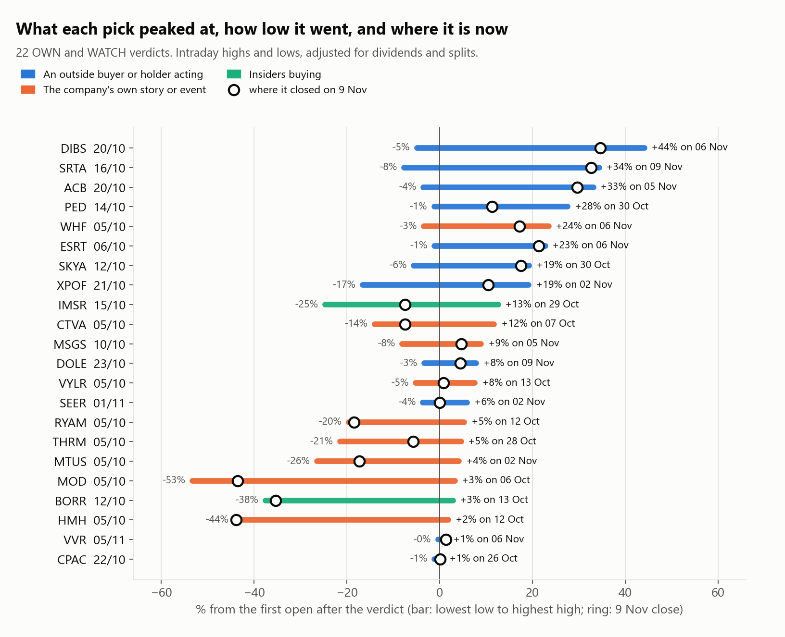
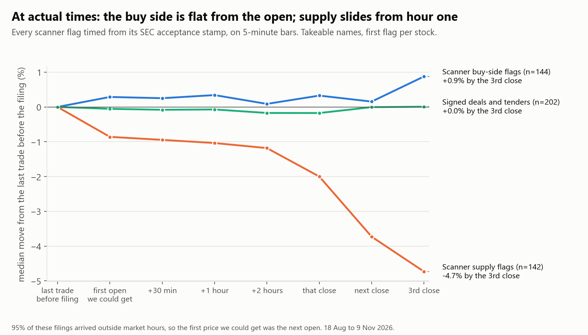

# Two-month review, part 2: peaks and what happened at actual times

*Written 10 Nov 2026, after the trader's challenge to [part 1](REPORT.md): "I want what they peaked at, and what they did after an event we checked for. I don't care if I hold for 2 hours." Priced to the 9 Nov close. The filing-by-filing account is in [EVENTS.md](EVENTS.md).*

## The short answer

1. **Peaks confirm the split in our picks.** The outside-buyer picks peaked high and late: a median peak of +16% in the first 10 sessions, still rising at the end. The company-story picks peaked small and early (a median of +3%) and then fell.
2. **There is no hours-scale edge on the buy side.** 95% of the filings we flag arrive outside market hours, so the reaction is in the overnight gap. From the first open we could get, the scanner's buy-side flags were flat at 30 minutes, 1 hour, 2 hours and the close.
3. **The supply side slides from the first hour.** Supply flags were down 1.3% from the open by that close, 3.2% by the next close and 4.2% by the third. Nearly half touched -10% within three sessions.
4. **Results days are decided in the gap.** Across 537 results releases, what a stock did after the open was a coin flip, whether it had gapped up or down. The bounce I saw in our own picks (6 of 8) does not hold up on the wider set.
5. **No exit rule rescues the buy side.** Every take-profit and stop combination averaged about zero before costs and about -3% after yours. What mattered was which stock, not when to sell.

## 1. What each pick peaked at

From the first open after the verdict, on intraday highs and lows.

| Verdict | Stock | Entry | Peak | Peak date (session) | Worst before the peak | Low | Low date | Now | Given back from the peak |
|---|---|---|---|---|---|---|---|---|---|
| 20/10 | DIBS | $4.30 | +44.2% | 6 Nov (13) | -4.9% | -4.9% | 21 Oct | +34.7% | -6.6% |
| 16/10 | SRTA | $4.56 | +34.4% | 9 Nov (16) | -7.7% | -7.7% | 2 Nov | +32.7% | -1.3% |
| 20/10 | ACB | $3.98 | +33.2% | 5 Nov (12) | -3.5% | -3.5% | 26 Oct | +29.6% | -2.6% |
| 14/10 | PED | $13.04 | +27.6% | 30 Oct (12) | -1.2% | -1.2% | 15 Oct | +11.3% | -12.8% |
| 05/10 | WHF | $6.91 | +23.5% | 6 Nov (24) | -3.4% | -3.4% | 7 Oct | +17.2% | -5.2% |
| 06/10 | ESRT | $4.39 | +22.8% | 6 Nov (23) | -1.1% | -1.1% | 7 Oct | +21.4% | -1.1% |
| 12/10 | SKYA | $2.51 | +19.3% | 30 Oct (14) | -5.6% | -5.6% | 13 Oct | +17.5% | -1.5% |
| 21/10 | XPOF | $4.29 | +19.2% | 2 Nov (8) | -16.6% | -16.6% | 30 Oct | +10.5% | -7.3% |
| 15/10 | IMSR | $3.24 | +12.7% | 29 Oct (10) | -16.7% | -24.7% | 5 Nov | -7.4% | -17.8% |
| 05/10 | CTVA | $13.08 | +11.8% | 7 Oct (2) | -1.8% | -14.0% | 28 Oct | -7.4% | -17.2% |
| 10/10 | MSGS | $304.49 | +9.0% | 5 Nov (19) | -8.0% | -8.0% | 27 Oct | +4.6% | -4.0% |
| 23/10 | DOLE | $13.38 | +7.9% | 9 Nov (11) | -3.3% | -3.3% | 30 Oct | +4.5% | -3.2% |
| 05/10 | VYLR | $71.91 | +7.6% | 13 Oct (6) | -0.9% | -5.2% | 6 Nov | +0.9% | -6.3% |
| 01/11 | SEER | $1.68 | +6.0% | 2 Nov (1) | -1.8% | -3.6% | 5 Nov | 0.0% | -5.6% |
| 05/10 | RYAM | $6.98 | +5.3% | 12 Oct (5) | -6.2% | -19.6% | 9 Nov | -18.5% | -22.6% |
| 05/10 | THRM | $32.23 | +4.7% | 28 Oct (17) | -21.5% | -21.5% | 22 Oct | -5.7% | -9.9% |
| 05/10 | MTUS | $21.13 | +4.2% | 2 Nov (20) | -7.6% | -26.5% | 5 Nov | -17.3% | -20.6% |
| 05/10 | MOD | $188.00 | +3.3% | 6 Oct (1) | -1.8% | -53.3% | 5 Nov | -43.5% | -45.3% |
| 12/10 | BORR | $4.98 | +2.9% | 13 Oct (1) | -3.6% | -37.6% | 5 Nov | -35.3% | -37.2% |
| 05/10 | HMH | $19.11 | +1.9% | 12 Oct (5) | -7.1% | -44.0% | 9 Nov | -43.9% | -44.9% |
| 05/11 | VVR | $2.86 | +1.4% | 6 Nov (1) | -0.3% | -0.3% | 6 Nov | +1.4% | 0.0% |
| 22/10 | CPAC | $12.78 | +0.6% | 26 Oct (2) | -0.5% | -1.1% | 5 Nov | +0.2% | -0.5% |

WHF and MSGS entries are adjusted for a dividend and a spin-off.

- **Median peak +8.4%, mean +13.8%.** 10 of 22 peaked at +10% or more, and 6 at +20% or more.
- **The winners needed patience.** Their peaks came 8 to 24 sessions in. None would have been stopped out at -10% on the way, except XPOF (-16.6% first).
- **The losers never offered an exit.** MOD, BORR and HMH peaked at +2% to +3% in the first week. MTUS made its high on 2 Nov, the day its results came out after the close.
- **Only 8 of 22 touched +10% before -10%.**

### Peaks against the base rate

Cheap stocks swing, so a peak means little without a comparison. Share that touched one level before the other in the first 10 sessions, with unflagged stocks in the same price band in brackets.

| Group | Names | Touched +10% first | Touched -10% first | Median peak | Median low |
|---|---|---|---|---|---|
| Picks: an outside buyer or holder acting | 9 | 56% (30%) | 11% (38%) | +16.3% (+6.4%) | -3.5% (-8.8%) |
| Picks: company story, or insiders | 11 | 18% (13%) | 45% (29%) | +3.4% (+3.0%) | -7.6% (-5.6%) |
| Every long-side name we wrote up | 59 | 27% (20%) | 29% (26%) | +5.8% (+4.7%) | -6.6% (-5.2%) |
| Activists and big holders | 10 | 30% (28%) | 20% (35%) | +9.5% (+6.3%) | -4.4% (-7.7%) |
| Contracts and catalysts | 14 | 29% (15%) | 50% (28%) | +5.3% (+3.5%) | -14.9% (-5.8%) |
| Insider buying | 10 | 30% (29%) | 50% (31%) | +9.3% (+5.9%) | -13.6% (-6.5%) |
| Scanner buy-side flags, takeable | 68 | 24% (24%) | 37% (30%) | +6.2% (+5.4%) | -8.5% (-6.0%) |
| Scanner supply flags, takeable | 120 | 26% (23%) | 58% (34%) | +6.7% (+5.2%) | -18.0% (-7.1%) |
| AVOID register, takeable | 37 | 19% (27%) | 62% (32%) | +9.4% (+5.8%) | -21.3% (-7.0%) |

- **Scanner buy-side flags pop a little more in the first week** (24% touch +10% first in 5 sessions, against 15% for similar stocks), but by 10 sessions the upside matches the base rate and the downside is worse.
- **Supply names peak on day 2 and bottom around day 8.** 43% of takeable supply flags touched -20% before +20%, against 15% of similar stocks.
- **The squeeze risk is visible here too:** 19% of takeable register names touched +20% before -20%, against 11% of similar stocks.

## 2. At actual times: every scanner flag from its SEC timestamp

1,218 flagged filings, each timed from its SEC acceptance stamp and followed on 5-minute bars. Medians, takeable names, first flag per stock. "Gap" is the last trade before the filing to the first regular-session price we could get. Everything after is from that entry.

| Group | Filings | Gap | +30 min | +1 hour | +2 hours | That close | Next close | Third close |
|---|---|---|---|---|---|---|---|---|
| Buy-side flags (strategic review, 13D, issuer tender) | 144 | +0.3% | +0.2% | 0.0% | 0.0% | +0.1% | -0.2% | +0.2% |
| Signed deals and tenders | 202 | -0.1% | -0.1% | -0.1% | -0.2% | -0.1% | -0.1% | 0.0% |
| Special dividends | 41 | +0.5% | +0.1% | -0.1% | -0.3% | -0.4% | +1.2% | +0.9% |
| Spin-off 8-Ks | 66 | 0.0% | +0.5% | +0.1% | +0.2% | -0.1% | +0.5% | +1.1% |
| Supply flags (reverse split, registration, EFFECT) | 142 | -0.9% | -0.3% | -0.6% | -0.7% | -1.3% | -3.2% | -4.2% |

- **When they arrive.** Of 429 buy-side, deal, dividend and spin-off filings, 21 came during market hours and 408 outside them. Being quick during the session almost never applies. The first price is the next open, or thin pre-market trading.
- **How much is gone by then.** For 12% of them the stock had already moved 5% or more before the open (32 up, 20 down). For the rest the gap was small, and so was everything after it.
- **Inside the first session**, a buy-side flag's median best price was +2.1% within two hours and +2.6% by the close. 31% touched +5% that session. Over three sessions, 25% touched +10% and 18% touched -10%.
- **Supply flags:** 36% were up at the first close, 31% at the next and 28% at the third. Their median low over three sessions was -9.3%, and 47% touched -10%.

## 3. Results days

Results were the events that moved our picks most, so I checked them across every company in our scans: 537 results releases on stocks at $1 or more that traded $500k or more that day. 524 came outside market hours. Medians from the first open after the release.

| Overnight gap | Releases | +30 min | +2 hours | That close | Share up at the close | Next close | Third close |
|---|---|---|---|---|---|---|---|
| down 10% or more | 29 | +0.1% | -0.7% | +0.1% | 52% | -1.2% | -0.2% |
| down 5 to 10% | 43 | -1.1% | -1.1% | -1.0% | 42% | -1.0% | -1.7% |
| down 2 to 5% | 62 | -0.1% | -0.4% | -0.7% | 42% | +0.1% | -0.4% |
| within 2% | 242 | +0.1% | -0.1% | -0.2% | 45% | +0.1% | +0.4% |
| up 2 to 5% | 84 | -1.0% | -0.6% | 0.0% | 50% | +0.2% | +0.9% |
| up 5 to 10% | 41 | -0.7% | +0.3% | +0.9% | 51% | +0.6% | +0.7% |
| up 10% or more | 23 | -0.7% | -1.9% | -2.9% | 35% | -3.0% | -5.0% |

- **After the open it is a coin flip.** For gaps down of 5% or more (72 releases), the mean move from open to close was -1.1% (95% interval -3.8% to +1.5%). For gaps up of 5% or more (64), it was -1.1% (-3.9% to +1.8%).
- **Our own picks looked different, by luck.** After a results gap-down, 6 of our 8 names rose from the open that day: RYAM opened -10.4% and closed +13.7% from there, DIBS -12.4% then +17.9%, XPOF -6.8% then +14.9%. MOD and HMH kept falling (-14.7% and -10.5% more). Eight is too few, and the wider set says not to count on it.
- **Holder filings faded.** After the 17 13Ds and 13D/As on names we wrote up, the stock was higher three sessions later only 29% of the time (median -3.2%). XPOF's 30 Oct 13D/A is the pattern: +4.9% at the open, +8.3% in the first hour, -3.9% by the third close.
- **Deal news kept going.** ACB opened +7.6% on its 3 Nov deal, added +9.3% by the close and was +11.1% from that open the next day.

## 4. Would any exit have made it pay?

Enter at the first open after the find. Sell at the target if touched, at the stop if touched first, otherwise at the end of the window. Mean result per trade, before costs and (in brackets) after a 3.5% round trip.

| Group, 10-session window | Trades | +5% / -5% | +10% / -10% | +20% / -10% | Just hold |
|---|---|---|---|---|---|
| Scanner buy-side flags, takeable | 68 | +0.4% (-3.1%) | -0.8% (-4.3%) | -0.6% (-4.1%) | +0.9% (-2.7%) |
| Long-side names we wrote up | 59 | -0.5% (-4.0%) | -0.2% (-3.7%) | -0.2% (-3.7%) | -1.4% (-4.9%) |
| All OWN and WATCH picks | 20 | -0.2% (-3.7%) | +0.2% (-3.4%) | +0.9% (-2.6%) | +2.3% (-1.3%) |
| Picks: outside buyer or holder | 9 | +2.2% (-1.3%) | +4.5% (+1.0%) | +8.1% (+4.6%) | +11.6% (+8.1%) |
| Picks: company story, or insiders | 11 | -2.2% (-5.7%) | -3.4% (-6.9%) | -5.1% (-8.6%) | -5.4% (-8.9%) |

- **For the scanner flags and the write-ups, no cell is positive after costs.** Tighter targets raise the hit rate (46% reach +5% first) but the stops take it back.
- **On the outside-buyer picks, targets cost money.** Holding made +11.6%; a +10% target made +4.5%. Their peaks came late.
- **On the story picks, nothing helped.** Stops only made the loss smaller.
- One cell elsewhere in the grid looks good (scanner flags, no target, stop at -10%: mean +4.7%) but its median is -3.6%. One stock, AIOK at +166%, makes the mean.

## 5. Events on our calendar

All 37 dated events are in [EVENTS.md](EVENTS.md). The ones that mattered:

- **MSGR's first day of trading (27 Oct):** it opened 7.4% below the prior close and closed 6.5% below it. Two sessions later it was 14.2% above it. This was the spin-off selling we had flagged in advance (T004) and then let expire, because "sold down hard" had no price level.
- **CRMT on its waiver deadline (22 Oct), an AVOID name:** +57.6% at the day's high and +43.9% at the close. That is the squeeze risk in one line.
- **SKYA when its tender papers were due (15 Oct):** +7.5% on the day, +12.9% four sessions later.
- **BMM on day 45 of Elmet's prepayment (29 Oct):** -7.5% on the day, -32.3% four sessions later.
- **ZVIA on results (4 Nov):** +2.6% on the day, +27.4% two sessions later.

## 6. What this adds to part 1

- **The WATCH is the entry.** For the picks that worked, the gain came over two to five weeks from the WATCH date, with the big days landing on news we could not have timed.
- **Speed does not help us.** The filings land overnight and the market reprices before the open. Nothing in the first two hours pays for being there.
- **Selling rules do not create an edge.** They changed the shape of the results, not the sign.
- **MSGR is the one clean miss:** a dated event we had identified, a hard fall on day one and a rebound of about 22% from that close within two sessions, with no trigger written that could fire.
- These are descriptions of two months. The same limits as part 1 apply, and the pick groups are small.

## Method

- **Daily peaks:** highest high and lowest low from the first open after the verdict or find, on Yahoo daily bars adjusted for splits and dividends. "Touched first" uses daily highs and lows; when both levels were touched on the same day it is counted in neither column. Base rates come from 1,519 unflagged stocks in the same price band on the same start days, weighted as in part 1.
- **Actual times:** SEC acceptance timestamps from the EDGAR submissions feed, converted to New York time. Prices are Yahoo 5-minute bars for the last 60 trading days, with pre-market and after-hours bars where the stock traded. The entry is the open of the first regular-session bar at or after the timestamp. 1,218 of 1,480 ledger rows had both a timestamp and bars.
- **Results days:** every 8-K with item 2.02 filed from 18 Aug to 9 Nov by a company that appeared in our scans, with filings sharing an entry merged.
- **Exits:** a stop is filled at the stop level, or at the open if the stock opened below it. When a target and a stop were both touched on one day, the stop is taken.
- Code: [code/](code/README.md).
